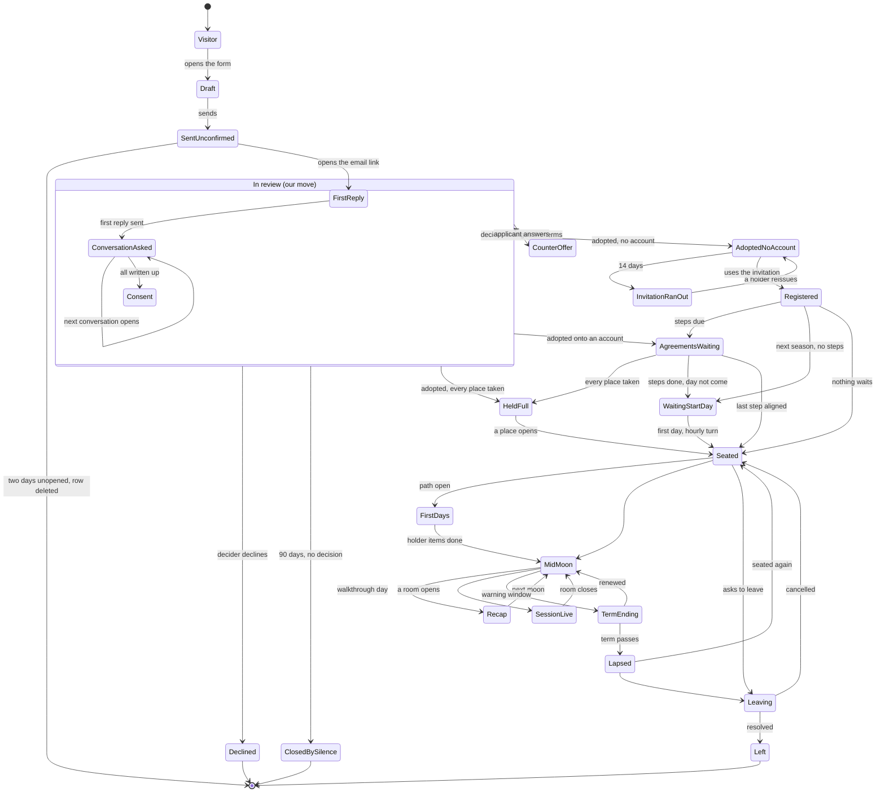

# The journey state map

Every state a person can be in, from a first visit to a seated holder in their first moon and beyond, read from the code at `a952b32` (main, 11 Nov 2026). For each state: what the person sees, the one next step each surface names, what reaches them by email and in the bell, what the guide would say, and how they leave the state. Then the places where surfaces disagree, and the exact rules for `shared/yourPath.ts`, the one conductor the Root lane builds.

How to read it:

- **Sourced** means read in the file named. **Inferred** means it follows from code that was read, without a run. **Gap** means the code has no record of the thing.
- Roles are named, never people. "The onboarding role" is the role the village names in `org.onboarding_role` (the role that welcomes people). "A holder of `org.seat`" is whoever holds the power to place people in roles.
- Open pull requests that change a state are named beside it: #1165 to #1174, as they stood on 11 Nov 2026.
- Nothing here changes product code. Severity follows the joining audit: **blocker** stops or betrays the person, **major** is clearly wrong or breaks a house rule, **polish** is friction.

## 1. The surfaces that name a next step today

| Surface | Where | Who sees it | What decides its words |
|---|---|---|---|
| The Trail | `client/src/components/NextStepTrail.tsx`, under the header on every page | Signed in only. Quiet on `/profile`, the auth doors, `/admin`, and the page the step points at | `me.nextAction` from `servedNextAction` (`server/index.ts` ~l.4694): `founderStepFor`, then `pickNextAction` over `GAME_CONFIG.nextActions` (`shared/gameConfig.ts` l.623) |
| Stage panel | `client/src/components/profileDash/StagePanel.tsx` l.139 | Profile, Today tab | The same `me.nextAction`, headed "Your next step to {next stage}" |
| Start here card | `client/src/components/profile/StartHereCard.tsx` l.183 | Profile owner, Quests tab | Its own logic: admitted → "Bring the village a quest"; not admitted → "Become a member" or "Your request is with the village" |
| Steps before your role starts | `client/src/components/profile/RoleStartSteps.tsx` | Profile, every tab, first | `GET /api/profile/role-start-steps` (`server/routes/confidentiality.ts` l.242): adopted applications not yet seated, with their `org.start_after_*` steps |
| Your move | `client/src/components/profile/YourMoveCard.tsx` | Profile, Today and Roles tabs | Every alignment text waiting on the reader (`fetchMyAlignments`) |
| Propose banner | `client/src/components/roleProposal/ProposeBanner.tsx` | Profile, Today and Roles tabs | `GET /api/governance/role-proposals/nudge` (next season's proposal window) |
| Today strip | `client/src/components/profileDash/TodayStrip.tsx` | Profile, Today tab | Asks, consents, session tasks, messages, the next session of the member's circle; "Nothing waits on you today" when empty |
| Our first days | `client/src/components/profile/OnboardingPath.tsx` (`id="onboarding"`) | Profile, Today and Roles tabs, below the task cards | The holder's onboarding path (`server/lib/onboarding.ts`), opened at seating when the village switched the path on |
| My moon | `client/src/components/myMoon/MyMoon.tsx` (`id="my-moon"`) | Profile, Roles tab | `GET /api/me/moon`: walkthrough day, send-by day, recap status |
| Status page | `client/src/pages/ApplicationStatus.tsx`, `/application-status/:ref` | The applicant, by the emailed token or signed in | `statusFor` (`shared/applicationReview.ts` l.321) via `statusOf` (`server/lib/applicationReview.ts` l.499) |
| Session next-step bar | `client/src/components/sessions/NextStepBar.tsx` | The facilitator in a live room | The room's stage |
| The guide (companion) | `client/src/components/companion/CompanionPanel.tsx` → `POST /api/agent/ask` | Signed in only ("Sign in to ask") | Village readers only: roles, seats, circles, quests, badges, decisions, events, canvas (`server/lib/villageReaders.ts`). `ownRecord: []` (`server/routes/companion.ts` l.315): **it reads nothing about the person's own journey** |
| Talk it out | `POST /api/guide/field` (`server/routes/fieldGuide.ts`) | Signed in only | The text box only. Knows nothing of the person's state |
| The connector | the member's own assistant through the village's MCP connector | Members who connected it | Their moon, seats, task board and season (`get_my_moon`, `get_my_seats`, `get_season`). Nothing about a proposal, agreements waiting or the onboarding path |

The current rule order (`shared/gameConfig.ts` l.623), first match wins: founder setup (before launch) → training → membership waiting → membership → first days (onboarding open) → first quest → finish quest → thank someone → find your lines → find your next Quest. **No rule knows a proposal, an adoption, agreements before a start, a held seat, a recap, a term ending, a live session or a departure.**

## 2. The states

| # | State | Record that says so | How a person enters | How they leave |
|---|---|---|---|---|
| S0 | Visitor | No account, no proposal token | Arrives at `/`, `/steward`, `/roles` | Starts a proposal (S1), signs the letter as a stranger, or makes an account |
| S1 | Proposal draft | Open form: nothing stored (form state in the tab). Member door: a saved draft (`/role-proposals/new`, autosaves) | Opens `/propose-a-role` or `/roles/select` | Sends (S2); closes the tab (open form: lost) |
| S2 | Sent, unconfirmed | `open_role_proposals.status = 'unconfirmed'` | `POST /api/open-proposals` | Opens the email link within 48 hours (S3); or silence: the row is deleted after 48 hours (`tidyOpenProposals`) |
| S3 | Confirmed, waiting for the first reply | status `confirmed`; review step `confirmed`, no `first_reply` | `POST /api/open-proposals/confirm` (`confirmAndAsk` also asks the circle) | The onboarding role sends the first reply (S4) |
| S4 | Conversation asked | `application_interviews.state = 'open'` | First reply stamped, or the previous conversation written up | Its holder writes it up (`scored`) or every holder steps out (`skipped`); next conversation opens, or all done (S5) |
| S4b | Conversation booked | **Gap.** No state between `open` and `scored`; the time is arranged by email outside the platform | | |
| S5 | Conversations done, circle's consent | Every interview `scored` or `skipped`; `scores_in` step; consent asks open (`asksFor`) | Last conversation written up | Adopted (S9 / S11) or declined (S7) by a holder of `org.seat` |
| S6 | Counter-offer open | `body.counterOffer` has a revision whose changed settings carry no reply | A decider saves new terms (`POST /api/open-proposals/:id/terms`) while status is `confirmed` | The applicant answers on the status page (`/api/application-status/:ref/terms`); or the decider adopts on a second deliberate click while talks are open |
| S7 | Declined | status `declined`; `decided` step `declined` | A decider declines | Final. The applicant may propose again |
| S8 | Withdrawn | Member door: `seat_applications.status = 'withdrawn'` via `POST /api/governance/role-applications/:id/withdraw`. Open form: **no withdraw door exists** | Member door only, by the applicant | Final |
| S8b | Closed by silence | open form: `confirmed` 90 days with no decision → `expireUndecidedBefore` sets `withdrawn`, removes name and address; the review is cleared and the status token removed | The daily tidy job | Final. Nobody is told (see C5) |
| S9 | Adopted, no account yet | status `adopted`; an invitation `openInviteId(p.id)`, unused, 14 days (`INVITE_DAYS`) | A decider adopts an address with no account | Uses the invitation (S10); or it runs out (S9b) |
| S9b | Invitation ran out | invitation expired, unused | 14 days pass | Only a holder of `org.seat` can reissue (`POST /api/open-proposals/:id/invitation`). After 90 days the proposal is anonymised |
| S10 | Registered | account made through the invitation; `arrivalFor` places every adopted proposal for the address (`placeOnRoles`) | `/register?invite=...` | Lands on `/profile/characters?first=1` today (M7); #1171 lands on `/profile` |
| S11 | Adopted onto an existing account | `placeOnRoles` at adoption; no invitation | A decider adopts an address that has an account | Same as S10 from here |
| S12 | Agreements waiting | `seat_applications.status = 'adopted'`, nobody seated, `stepsBeforeStart` non-empty (`org.start_after_confidentiality`, `_membership`, `_paid_terms`) | Adoption with a dial on and the step not done | Aligns with each; the hourly `season-plan-turn` (or the confidentiality door at once) seats them (S13) |
| S12b | Adopted, waiting for the start day | `adopted`, no steps, `firstDayOf(app)` in the future (next season's first day) | Adoption for next season | The season turn seats them on the day |
| S12c | Adopted into a full role | `seat_applications.status = 'held-full'` | Adoption when every place is taken (today silent, B3) | A place opens and the hourly job seats them; #1173 refuses this by default and offers "Adopt for when a place opens" |
| S13 | Seated | `org_role_assignments` live row; notice "You were seated as {role}" (`role_appointed`); grant tasks raised | `seatInTransaction` | Term ends (S18 / S19), leaves (S20) |
| S14 | First days | onboarding path open with an item the holder owns (`hasOpenOnboardingItems`) | `openPathFor` at seating, only when the village switched the path on (`pathEnabled`) | Every holder item ticked |
| S15 | Mid-moon | seated, inside a moon, before the walkthrough day | Each new moon | Walkthrough day arrives (S16) |
| S16 | End-of-moon recap | `moon_recaps.status` `draft` → `waiting` → `returned` / `approved`; walkthrough day and send-by day from `shared/moonRhythm.ts` | Walkthrough day | Sends the recap; it is approved or returned with a note |
| S17 | Session live | an open room (`openRoom`) for a circle the member sits in | A facilitator opens the room | The room closes; actions land on the task board |
| S18 | Term ending | `term_expiring` notice window open (`server/lib/stewardship.ts` ~l.2297) | Last stretch of the term | Renewed through `/season-plans/mine?renew=`, or lapses |
| S19 | Lapsed | `isLapsed` (org seat reads `expired`); permission holdings end with the term | Term end passes without renewal | Seated again by a new application, or leaves |
| S20 | Leaving | `exits.status` `open` or `settling` | `POST /api/profile/request-exit` or an admin opens one | `resolved` (tombstoned, S21) or `cancelled` (stays) |
| S21 | Left | tombstone (`departed.ts`) | Exit resolved, or account deleted | Final. Cannot sign in |
| S22 | Agent holding a role (#1174, not on main) | `org_role_assignments.holder_kind = 'documented'`, `holder_key = agent:<slug>`, `keeper_user_id` | A member proposes an agent they keep; a holder of `org.seat` and `org.seatAgent` adopts | Seating ended by a person |

The member side, which the current rules already cover: **guest unsigned** (no `membershipGranted`, no waiting signing), **membership waiting** (a signing the village has not answered, or a membership letter aligned from the account, which also files a signing), **member**.

## 3. The state diagram



(Mermaid labels are kept short; the table in section 2 is the authority.)

## 4. Per state: what each surface says

Abbreviations: **Trail** = the Trail and the Stage panel (same rule). **Start** = Start here card. **RSS** = Steps before your role starts. **Move** = Your move. **Status** = the status page. **Bell** = in-app notice (emailed when the member's notification preferences say so). "None" means the surface draws nothing.

### S0 Visitor
| | |
|---|---|
| Screens | `/`, `/steward` (hero is village data; on one live village its main act leaves the site, audit M15), `/roles`, `/roles/select` |
| Trail / Start / RSS / Move | None (signed out) |
| Emails / Bell | None |
| Guide | Not offered: the companion and Talk it out need sign-in; Ask Sera on the form needs sign-in |
| Leaves by | Opening the form |
| PRs | #1172 (role tiles show commitment, sticky stepper), #1168 (Spanish on `/roles`) |

### S1 Proposal draft
| | |
|---|---|
| Screens | `/propose-a-role` (one long form), or the member door `/role-proposals/new` |
| Next step named | The form's own Send. Errors one at a time at the top (M1) |
| Emails / Bell | None |
| Guide | Signed in: Ask Sera drafts fields, Talk it out per box. Visitors: none |
| Leaves by | Send. Closing the tab loses the open form |
| PRs | #1172 fixes the lockout (B1), shows every gap beside its field (M1), adds a four-part trail and the breathing loader |

### S2 Sent, unconfirmed
| | |
|---|---|
| Screens | "Check your email" notice with a gust of leaves (`Burst`) and the steps after confirming (`NextForRoles`) |
| Next step named | "Check {email}. We sent a link to confirm it's you." No resend, no date the link stops |
| Emails | `open_proposal.confirm`: confirm link, "The link works for 48 hours" |
| Bell | None (no account) |
| Guide | None |
| Leaves by | Opening the link (S3); else the row is deleted after 48 hours with no email |
| PRs | None |

### S3 to S5 In review (first reply, conversations, consent)
| | |
|---|---|
| Screens | Confirm page: "Confirmed" plus "Follow where your proposal is". Then the status page |
| Status says | Step eyebrow, "Whose move", a "by" date: first reply due (3 business days from confirm), conversation due (14 days from opening, which is the onboarding role's nudge date), consent close date |
| Trail | If the applicant already has an account: whatever the member rules say (training, quests). Nothing about the proposal |
| Emails | `open_proposal.status` (the status link, once); `open_proposal.update` per moment: confirmed, first reply, conversation (2nd and later only), consent. Conversation and consent letters carry no link today (M6) |
| Bell | `applicant_update` copies, only when the address already has an account |
| Guide | Nothing about the proposal |
| Leaves by | Adopted, declined, or 90 days of silence |
| PRs | #1168: one step "now" at a time, "While you wait" doors (quests, map, events), Spanish, signed links in every letter |

### S6 Counter-offer open
| | |
|---|---|
| Screens | Status page shows the changed settings with Accept or Talk again (`applicantOffer`) |
| Next step named | The email: "Open your status page to read them" (no link today) |
| Emails | `open_proposal.update` kind `terms`, per revision |
| Decider side | Adopt answers 409 `terms_open` once, then adopts on a second click |
| Leaves by | Answering; or adoption over open talks |
| PRs | #1168 adds the link; #1173 carries the agreed terms into what is signed (B2) and adds a save bar (M5) |

### S7 Declined
| | |
|---|---|
| Screens | Status page "Thank you for proposing", doors to quests and roles |
| Emails | `open_proposal.declined`: quest link, roles link, "propose again next season" |
| Trail | Member rules if they have an account |
| Leaves by | Final. Name and address go after 90 days |
| PRs | #1168 drops unstarted steps from the path |

### S8 Withdrawn and S8b Closed by silence
| | |
|---|---|
| Screens | Member door: application page reads "Withdrawn". Open form: no withdraw door. After the 90-day close the status link answers "That link does not match a proposal" |
| Status says | "Nobody. You withdrew this proposal." (unreachable for the open form) |
| Emails | None, in either case |
| PRs | None (see C5) |

### S9 Adopted, no account and S9b Invitation ran out
| | |
|---|---|
| Screens | Status page: "Yours: make your account. The link to make it is in your email." No button |
| Emails | `open_proposal.adopted` with the invitation, "works once and lasts 14 days", the membership letter link when not aligned |
| Leaves by | Using the invitation. After 14 days only a holder of `org.seat` can reissue; the applicant has no door to ask |
| PRs | #1173 adds "What comes next" to both adoption letters (P11) |

### S10 Registered and S11 Adopted onto an existing account
| | |
|---|---|
| Screens | `/register` asks the path again, then `/profile/characters?first=1` (M7). S11: the letter points to `/profile` |
| Trail | First matching member rule: usually "Finish your community training" |
| Emails | `auth.verify_email` sent though the invitation proved the address (P9); S11 gets `open_proposal.adopted` (account letter) |
| Bell | "Adopted" notice (`governance`), the steps notice when steps wait, earlier applicant updates carried onto the profile |
| PRs | #1171: invitation skips the path question and the picker, lands on `/profile`; invited address starts verified |

### S12 Agreements waiting
| | |
|---|---|
| Screens | Profile: RSS "Two steps before your role starts" (confidentiality inline, membership → `/love-letter`, paid terms → `/role-applications/:id`). Move: "Align with {title}" per waiting text. Today: "Nothing waits on you today" |
| Trail | "Finish your community training", or, once the letter is aligned, "Your {commitment} is with the village. Take a Quest while you wait" |
| Start | Not admitted: "Become a member, Sign the {commitment}"; after aligning: "Your request is with the village" |
| Emails / Bell | Notice `START_WORDS.title(n)` with the steps and "Your role starts within the hour after the last one", linking the first step (confidentiality → `/aligned`, while the profile aligns inline) |
| Guide | Nothing |
| Leaves by | Last alignment; the season turn seats within the hour, or on the first day when that is later |
| PRs | #1171 one "Before you start" card with every step and its door, Today points at it, M9 and M18 fixed. #1173 shows "starts when a place opens" for a full role |

### S12b Waiting for the start day
| | |
|---|---|
| Screens | RSS draws nothing once no steps wait, so nothing on the profile says when the role starts. Application page shows the term |
| Words when steps did wait | "within the hour after the last one", false for a next-season start (C2) |
| PRs | None |

### S12c Adopted into a full role
| | |
|---|---|
| Today | The applicant hears "adopted", aligns, is told "within the hour", and nothing starts (B3) |
| PRs | #1173 refuses by default; "Adopt for when a place opens" with honest words in the letter, bell and RSS |

### S13 Seated and S14 First days
| | |
|---|---|
| Screens | Profile: Your roles, player card, OnboardingPath ("Your first days" by default, the village's title when set) below the ask form and task cards (M8) |
| Trail | Training first if untrained; "Finish your first days in your role" → `/profile#onboarding` only after training and membership are clear |
| Bell | "You were seated as {role}" (`role_appointed`); grant tasks to the granting role |
| Profile also shows | Stage, rank bar "Next: Guide", abilities, forge gifts, ProposeBanner for next season (P7) |
| Leaves by | Holder items ticked |
| PRs | #1171 hides stage and rank for 14 days, "Our first 14 days" right under the card, human dates. #1166 lets an onboarding step carry a link |

### S15 Mid-moon
| | |
|---|---|
| Screens | My moon on the Roles tab; task board; MoonDock |
| Trail | Member rules: "Take your first Quest", "Thank someone this cycle", or "Find your next Quest". Nothing about the role |
| Bell | Task nudges (due within two days, asked of you), in-app only |

### S16 End-of-moon recap
| | |
|---|---|
| Screens | My moon: walkthrough day, "Send by {weekday} {day}", Ask Sera to gather, Send my recap |
| Trail | Member rules. Nothing about the recap |
| Bell | Nothing before sending (no "your recap is due" notice exists). After: returned, work approved, approved, paid (`NOTICE_WORDS`, `shared/moonRecap.ts` l.3087) |
| Connector | `get_my_moon` reads it |

### S17 Session live
| | |
|---|---|
| Screens | Today strip card "Live session · {words}", meta "Add to the agenda", built from the NEXT meeting of the member's circle whether or not it is live (C10) |
| Trail | Nothing |
| Room | The facilitator's NextStepBar; the close stage hands the participant nothing to carry |

### S18 Term ending and S19 Lapsed
| | |
|---|---|
| Bell | `term_expiring`: "Your term on {role} ends in N day(s)" / "Carry on into the next moon?" / "has ended", linking `/season-plans/mine?renew=` |
| Profile | Your roles: "Until {day}" / "Its term has ended", no door |
| Trail | Nothing |

### S20 Leaving and S21 Left
| | |
|---|---|
| Screens | `/exit-policy`; admin desk settles and resolves |
| Trail | Keeps naming quests and thanks |
| Leaves by | Cancelled or resolved |

### S22 Agent holding a role (#1174)
| | |
|---|---|
| Who sees what | The agent has no account, so no profile, Trail, RSS or onboarding path. The keeper gets a bell notice at adoption or decline |
| Term end | The `term_expiring` loop skips `holderKind !== 'member'`, so neither the agent nor its keeper is told (C19) |

## 5. Contradictions, dead ends and doors that lead nowhere

| id | What disagrees | Where | Sev | Fixed by |
|---|---|---|---|---|
| C1 | The one next-step rule knows nothing of the role journey. A holder with agreements waiting, held for a seat, or seated in first days is told "Finish your community training" or "Take a Quest while you wait" on the Trail and the Stage panel, while the steps card names the agreements | `server/lib/nextAction.ts` `applies`, `shared/gameConfig.ts` l.623, `server/index.ts` `nextActionFor` | major | None. This is the Root's job |
| C2 | "Your role starts within the hour after the last one" is false for any application whose first day is later (next season, or a moon not begun): `notYet` holds it until `firstDayOf(app)` | `shared/roleStartWords.ts` `START_WORDS.after`, `stepsBody`; `RoleStartSteps.tsx`; `server/lib/seatApplicationCloser.ts` `firstDayOf` | major | #1173 fixes only the full-role case |
| C3 | The adoption letter says aligning with the membership letter "is what makes you a member, with a voice in the village's decisions". Membership is `membershipGranted`, set only when a steward accepts the filed signing. After aligning: RSS counts the step done, the Trail says "Your {commitment} is with the village", Start says "Your request is with the village" | `shared/applicantWords.ts` `adopt.signFirst` (en l.179, es l.255); `server/index.ts` `hasMembership`; `client/src/pages/LoveLetter.tsx` header | major | None |
| C4 | Status page tells an applicant adopted onto an existing account "make your account. The link is in your email", but that branch makes no invitation and the letter says "sign in" | `shared/applicationReview.ts` `statusFor` l.334; #1168 `status.move.adopted` | major | #1168 keeps the line |
| C5 | An open-form proposal nobody decides for 90 days is closed as `withdrawn`, anonymised and its review cleared, with no email. The status link then says "That link does not match a proposal. Check the link in your email." The only words for `withdrawn`, "You withdrew this proposal", are unreachable: the open form has no withdraw door | `server/routes/openProposals.ts` `tidyOpenProposals`; `server/repos/openProposals.ts` `expireUndecidedBefore`; `server/repos/applicationReview.ts` `clearReviewOf` | major | None |
| C6 | "Check your email" has no resend and no date; an unopened proposal is deleted after 48 hours with no word. The leaves gust draws nothing under reduced motion (rule: a still drawing) | `client/src/pages/ProposeARole.tsx` l.343; `client/src/components/roleDraft/Burst.tsx` | polish | None |
| C7 | The invitation lasts 14 days; when it runs out the applicant's letter and status page offer no way to ask for a new one. Only a holder of `org.seat` can reissue | `server/lib/invites.ts` `INVITE_DAYS`; `server/routes/openProposalDecide.ts` `/invitation`; `shared/applicantWords.ts` `adopt.inviteWorks` | major | None |
| C8 | Nine voices on one profile disagree. For an adopted, untrained, not-admitted holder at once: Stage "Finish your community training"; Start "Sign the {commitment}"; RSS "Align with the membership letter"; Move "Align with {terms}"; Propose banner "Propose your roles for next season"; Today "Nothing waits on you today" | `client/src/pages/Profile.tsx` l.406 to 600 | major | #1171 merges RSS and Move, points Today at the card, hides the next-season prompt for 14 days. Stage and Start still disagree |
| C9 | The Stage panel heads the next step "Your next step to {next stage}", so a seated holder reads "Your next step to Guide: Thank someone this cycle". It frames a person's step as climbing a rank | `client/src/components/profileDash/StagePanel.tsx` l.144 | major | #1171 hides it for 14 days only |
| C10 | Today strip labels the next meeting of any circle the member sits in as "Live session" with "Add to the agenda", whether or not a room is open | `client/src/components/profileDash/useDashData.ts` l.195; `TodayStrip.tsx` l.101 | major | None |
| C11 | A seated holder past first days is told "Take your first Quest". Mid-moon, recap, term ending and session live have no rule, so the role never appears in the next step | `shared/gameConfig.ts` nextActions | major | None |
| C12 | No notice tells a holder their moon recap is due before the send-by day; the only signal is My moon on the Roles tab | `server/lib/moonReview.ts`, `shared/moonRecap.ts` `NOTICE_WORDS` (only after sending) | major | None |
| C13 | Your roles says "Its term has ended" with no door, while the bell's `term_expiring` links to `/season-plans/mine?renew=` | `client/src/components/profile/YourRolesSection.tsx` l.71; `server/lib/stewardship.ts` ~l.2310 | polish | None |
| C14 | With an exit open the Trail still offers quests and thanks | `shared/gameConfig.ts` nextActions | polish | None |
| C15 | The guide reads nothing of the person's own state (`ownRecord: []`), so it can say nothing about their next step and can contradict the Trail. It is also closed to visitors | `server/routes/companion.ts` l.315; `server/lib/villageReaders.ts` | major | None (#1120 on hold routes the companion through Sera) |
| C16 | A visitor has no thread at all between screens: no Trail, no guide, and a proposal sent from a phone is not remembered there | `NextStepTrail.tsx` (`if (!user)`) | major | None |
| C17 | #1168's "While you wait" doors go to `/map` and `/events`, which are modules that ship off; a village with them off shows a module gate | #1168 `client/src/pages/ApplicationStatus.tsx` | polish | Introduced by #1168 |
| C18 | Letters with no way back: "terms changed" and "a conversation is asked for" (M6); the 90-day close (no letter, C5); the run-out invitation (C7); the 48-hour deletion (C6) | `shared/applicantWords.ts`, `server/lib/applicantUpdates.ts` | major | #1168 fixes M6 only |
| C19 | Agents: a next-season agent proposal is seated at once (`seatAdoptedAgent` sets no start); the term-ending loop skips documented holders so nobody hears an agent's term end; no agreement or onboarding path applies to an agent seating and its keeper's path has no step for it | #1174 `server/lib/agentRoleProposals.ts`; `server/lib/stewardship.ts` ~l.2297 | major | Introduced by #1174 |
| C20 | #1171 and #1173 both change `RoleStartSteps.tsx` and `server/routes/confidentiality.ts` with different shapes (a merged "Before you start" card; `waitsForSeat`) | both PRs | integration | Land one, rebase the other |
| C21 | Two clocks for "first days": #1171's `FIRST_DAYS = 14` hides ranks for 14 days, while the onboarding path runs to its own `dueOn` (`lastDayOf(items)`) under the village's own title | #1171 `shared/roleStartWords.ts`; `server/lib/onboarding.ts` `openPathFor` | polish | None |
| C22 | "Booked" has no record: a conversation is `open` until written up, so the applicant never sees a booked time, and the "by" date shown is the onboarding role's 14-day nudge date | `shared/applicationReview.ts` `INTERVIEW_STATES`, `interviewDueAt` | polish | None |
| C23 | "Love Letter" is written into the adoption letter in English and Spanish, while every other surface uses the village's `commitmentName` | `shared/applicantWords.ts` l.179, l.255 | polish | None |
| C24 | Move's footer "Your role starts once every agreement it needs is aligned with" shows to any member with any alignment waiting, role or not | `client/src/components/profile/YourMoveCard.tsx` | polish | #1171 replaces the card |
| C25 | The steps notice links confidentiality to `/aligned`, the profile aligns it inline; two doors for one act | `shared/roleStartWords.ts` `stepHref` | polish | #1171 in part |

Already reported and fixed by an open PR, kept here so the map is complete: B1 lockout (#1172), B2 terms not carried (#1173), B3 full role (#1173), M7 register landing (#1171), M9 reason copy (#1171), M18 step with no door (#1171), M6 letters without links (#1168), M16 status words (#1168).

**Counts: 0 blocker, 16 major, 8 polish, 1 integration note.**

## 6. The spec for "your path" (`shared/yourPath.ts`)

### 6.1 What it is

One pure function that answers, for one person at one moment, the ONE next step and the dated "what comes after". Every surface that names a next step reads it: the Root strip (the Trail's successor), the profile's "Your path" card, the status page, the guide (as context, never as a decider), and the adoption and update letters' last line. Nothing else may compute a next step.

```ts
export function yourPath(f: PathFacts): PathAnswer
```

- Pure: no database, no clock (the caller passes `now` and `timeZone`), no locale (words are keys).
- Served as `me.path` in `GET /api/game/me` and as `status.path` in both status reads. Keep `me.nextAction` for one release as `{ id: path.state, label: <rendered step>, href }` so an older client still reads it (expand, never contract).
- Lives in `shared/` so the client can render a still path from a payload and tests need no server. The gathering of facts lives beside `nextActionFor` in a new `server/lib/pathFacts.ts` (server/index.ts may not grow).

### 6.2 Inputs

```ts
export interface PathFacts {
  now: Date;
  timeZone: string;                      // the season document's zone
  person:
    | { kind: "visitor"; deviceProposal: DeviceProposal | null }   // opt-in memory on this device only
    | { kind: "token"; proposal: ProposalFacts }                   // the status page, by its emailed link
    | { kind: "account"; role: string; founderPowerStands: boolean; proposals: ProposalFacts[] };
  applications: ApplicationFacts[];      // seat_applications of this account, not seated
  seatings: SeatingFacts[];              // live or lapsed this season, member holder rows only
  agentsKept: SeatingFacts[];            // seatings where keeper_user_id = this account (#1174)
  onboarding: { title: string; dueOn: string; next: { title: string; dueOn: string } | null } | null;
  moon: { today: string; walkthroughDay: string; sendBy: string; recap: "none" | RecapStatus; returnedNote: boolean } | null;
  sessionLive: { href: string; circle: string } | null;   // a room OPEN now, never the next meeting
  tasksDue: { count: number; nextDue: string } | null;     // due within two days
  proposeWindow: { href: string; closesOn: string | null } | null;
  exit: { status: "open" | "settling" } | null;
  member: NextActionFacts;               // trained, joining, claims, budget, geneKeysMissing (unchanged)
}

export interface DeviceProposal { email: string; sentAt: string }       // nothing else is kept
export interface ProposalFacts {
  ref: string; statusHref: string;                       // /application-status/:ref, with the token when it is a token read
  status: "confirmed" | "adopted" | "declined" | "withdrawn" | "expired";
  step: "first_reply" | "interview" | "consent" | null;   // statusFor().step while confirmed
  by: string | null;                                      // civil day of statusFor().by
  withRole: string | null;                                // the role holding the open conversation
  termsToAnswer: boolean;                                 // a revision whose changed keys have no reply
  invite: { until: string; used: boolean } | null;        // adopted, no account
  ownAccountAtAdoption: boolean;                          // adopted onto an existing account
  nextSeason: { name: string; opensOn: string } | null;   // for "propose again"
}
export interface ApplicationFacts {
  id: string; roles: string[];
  status: "adopted" | "held-full";
  steps: Array<{ step: StartStep; href: string }>;        // stepsBeforeStart, in START_STEPS order
  firstDay: string | null;                                // civil day of firstDayOf(app); null means now
}
export interface SeatingFacts {
  roleId: string; role: string;
  termEndsOn: string | null;
  warningOpen: boolean;                                   // the term_expiring window (stewardship.ts)
  lapsed: boolean;
  renewing: boolean;                                      // adoptedUnseatedSeats has it
}
```

Every field is a fact the server already holds; the file that reads it is named in section 2. Three need new reads: `exit` (exits repo), `sessionLive` (filter `/api/sessions` rows to `openRoom !== null`), `moon` (moonRecap's `resolveMoon` plus `walkthroughDay` / `sendBy`).

### 6.3 Output

```ts
export interface PathAnswer {
  state: PathState;                    // which rule matched, for tests and analytics-free debugging
  whose: "yours" | "ours" | "nobody";
  step: { key: PathKey; href: string | null; vars: Record<string, string> };
  after: { key: PathKey; vars: Record<string, string> } | null;   // a day is always in vars.day, a civil YYYY-MM-DD
  walked: PathMilestone[];             // the Seed of Life: one circle per milestone, in order
  quietOn: string[];                   // paths where the strip stays quiet (the step's own page)
}
export type PathMilestone = "proposed" | "confirmed" | "first_reply" | "conversations" | "adopted" | "account" | "agreements" | "seated" | "first_days" | "first_recap";
```

`walked` is the person's own walk. It is never totalled, compared, shown to anybody else or turned into a bar. It draws circles, nothing more.

### 6.4 The ordered rules

First match wins. A rule's `when` is exact; "account" means `person.kind === "account"`. `{role}` is the first role name; a list uses the locale's list words.

| # | state | when | whose | step (key → English) | href | after (key → English, date source) |
|---|---|---|---|---|---|---|
| 1 | `founder-setup` | account, role is founder or admin, `founderPowerStands` | yours | `path.founderSetup.step` → "Set up your village" | `/setup-game` | none |
| 2 | `leaving` | account, `exit` not null | ours | `path.leaving.step` → "Your leaving is with us. Read how it goes" | `/exit-policy` | `path.leaving.after` → "We write to you when it is settled." |
| 3 | `session-live` | account, `sessionLive` not null | yours | `path.sessionLive.step` → "Join the {circle} session now" | `sessionLive.href` | `path.sessionLive.after` → "What you carry out of the room lands on your task board." |
| 4 | `terms-to-answer` | any proposal `confirmed` with `termsToAnswer` | yours | `path.termsToAnswer.step` → "Read the terms we changed and answer" | `statusHref` | `path.termsToAnswer.after` → "We read your answer, then adopt or talk again." |
| 5 | `agreements` | account, an application `adopted` with steps | yours | `path.agreements.<step>` → confidentiality: "Align with the confidentiality agreement"; membership: "Align with the membership letter"; terms: "Align with your role's terms" | the step's href; confidentiality → `/profile#before-you-start` | if `firstDay` after today: `path.agreements.afterDay` → "Your role as {role} starts on {day}." Else `path.agreements.afterNow` → "Your role as {role} starts once the last one is aligned." |
| 6 | `held-for-seat` | account, an application `held-full` (with steps, rule 5 matched first) | ours | `path.heldForSeat.step` → "Read the terms you agreed for {role}" | `/role-applications/:id` | `path.heldForSeat.after` → "Every place in {role} is filled. Your role starts when one opens, and we tell you the day." |
| 7 | `start-day` | account, an application `adopted`, no steps, `firstDay` after today | yours | `path.startDay.step` → "Get to know {role} before it starts" | `/role-applications/:id` | `path.startDay.after` → "Your role starts on {day}." |
| 8 | `invitation` | token, proposal `adopted`, `invite` unused, `until` not passed, not `ownAccountAtAdoption` | yours | `path.invitation.step` → "Make your account with the invitation in your email" | none (the link lives only in the email) | `path.invitation.after` → "It works until {day}." |
| 9 | `invitation-ran-out` | token, proposal `adopted`, `invite` unused and `until` passed | ours | `path.invitationRanOut.step` → "Ask us for a new invitation" | the status page's ask door (new, see 6.7) | `path.invitationRanOut.after` → "We send a new one to the same address." |
| 10 | `adopted-sign-in` | token, proposal `adopted`, `ownAccountAtAdoption` | yours | `path.adoptedSignIn.step` → "Sign in to see your role" | `/login?next=/profile` | none |
| 11 | `recap-returned` | account, `moon.recap === "returned"` | yours | `path.recapReturned.step` → "Your moon recap came back with a note" | `/profile#my-moon` | none |
| 12 | `recap-due` | account, a live seating, `moon` not null, `today` ≥ `walkthroughDay`, `today` ≤ `sendBy`, recap `none` or `draft` | yours | `path.recapDue.step` → "Send your moon recap" | `/profile#my-moon` | `path.recapDue.after` → "Send it by {weekday} {day}." |
| 13 | `term-ending` | account, a seating with `warningOpen`, not `lapsed`, not `renewing` | yours | `path.termEnding.step` → "Say whether you carry on as {role}" | `/season-plans/mine?renew={roleId}` | `path.termEnding.after` → "Your term ends on {day}." |
| 14 | `lapsed` | account, a seating `lapsed`, not `renewing` | yours | `path.lapsed.step` → "Your term as {role} has ended. Say whether you carry on" | `/season-plans/mine?renew={roleId}` | `path.lapsed.after` → "The village can seat you again for another term." |
| 15 | `agent-term-ending` | account, an `agentsKept` seating with `warningOpen` or `lapsed`, not `renewing` | yours | `path.agentTermEnding.step` → "Say whether {agent} carries on as {role}" | `/season-plans/mine?renew={roleId}` | `path.termEnding.after` |
| 16 | `first-days` | account, `onboarding.next` not null | yours | `path.firstDays.step` → "Next in {title}: {item}" | `/profile#onboarding` | `path.firstDays.after` → "Due on {day}." (the item's `dueOn`) |
| 17 | `task-due` | account, `tasksDue` not null | yours | `path.taskDue.step` → "A task of yours is due {dayWords}" | `/profile#my-tasks` | none |
| 18 | `in-review` | any proposal `confirmed` (token or account) | ours | `path.inReview.step` → "While we read it, take a quest" | `/quests` | by `step`: first_reply → `path.inReview.firstReply` "The role that welcomes people writes to you by {day}."; interview → `path.inReview.interview` "Your conversation with {withRole} is next. We arrange a time with you."; consent → `path.inReview.consent` "The circle answers by {day}." (no day: the same line without "by {day}", key `consentNoDay`) |
| 19 | `declined` | token, proposal `declined` | nobody | `path.declined.step` → "Stay close: take a quest" | `/quests` | if `nextSeason`: `path.declined.after` → "You can propose again for {season}, from {day}." |
| 20 | `closed` | token, proposal `withdrawn` or `expired` | nobody | `path.closed.step` → "Look at the roles open now" | `/roles` | none |
| 21 | `propose-window` | account, `proposeWindow` not null, no onboarding path open | yours | `path.proposeWindow.step` → "Propose your roles for next season" | `proposeWindow.href` | if `closesOn`: `path.proposeWindow.after` → "The window closes on {day}." |
| 22 | `training` | account, not `trained`, holds no live seating | yours | `path.training.step` → "Finish your community training" | `/training` | none |
| 23 | `membership-waiting` | account, `joining === "waiting"`, holds no live seating | ours | `path.membershipWaiting.step` → "Your {commitment} is with us. Take a quest while you wait" | `/quests` | none |
| 24 | `membership` | account, `joining === "unsigned"` | yours | `path.membership.step` → "Sign the {commitment}" | `/love-letter` | none |
| 25 | `holder-moon` | account, a live seating, `moon` not null | yours | `path.holderMoon.step` → "Add this moon's work to your recap" | `/profile#my-moon` | `path.holderMoon.after` → "We walk through it together on {weekday} {day}." (walkthrough day) |
| 26 | `first-quest` | account, no claims | yours | `path.firstQuest.step` → "Take your first quest" | `/quests` | none |
| 27 | `finish-quest` | account, a claim `claimed` or `submitted` | yours | `path.finishQuest.step` → "Turn in your quest" | `/quests` | none |
| 28 | `thank` | account, gratitude left this cycle | yours | `path.thank.step` → "Thank someone this cycle" | `/gratitude` | none |
| 29 | `lines` | account, `geneKeysMissing` | yours | `path.lines.step` → "Find your lines" | `/profile/gene-keys` | none |
| 30 | `unconfirmed` | visitor, `deviceProposal` sent within 48 hours | yours | `path.unconfirmed.step` → "Open the link we sent to {email}" | none | `path.unconfirmed.after` → "It works until {day}." (sentAt + 48 hours, as a civil day) |
| 31 | `visitor` | visitor | yours | `path.visitor.step` → "Find where you belong" | `/roles` | `path.visitor.after` → "Then tell us about you and the role, a few short questions." |
| 32 | `explore` | always | yours | `path.explore.step` → "Find your next quest" | `/quests` | none |

Why this order:
- Rules 1 to 3 are things happening now or a person on their way out; nothing else is honest to say first.
- Rules 4 to 10 are the joining thread: whatever the person must do for their role to start comes before anything about the village at large. This is the rule that fixes C1.
- Rules 11 to 17 are a holder's dated duties, earliest-deadline kinds first.
- Rule 18 sits below them so an existing member who proposes still sees their own dated duties first; the proposal's dated line still shows on the status page, which always renders its own proposal's rule.
- Training and membership drop below the role journey (22 to 24) and stop applying to a seated holder as a step: for them membership is an agreement (rule 5) or a notice when the village answers.
- `holder-moon` (25) gives a seated holder a role-shaped step mid-moon, so C11 cannot recur.
- Gene Keys stays below every step of the game, as today.

When two items match one rule (two applications, two seatings), the one with the earliest date wins; ties break by role name. The other items are not lost: they appear in the whole-path view, never as a second "next".

### 6.5 Words

- Every key is a member of the `PathKey` union, and the tables are `Record<PathKey, ...>` per language, so a key without Spanish fails the typecheck (CLAUDE.md, the hand-kept map trap).
- Whole sentences only. Never join two keys into one sentence; never put a substituted name at a sentence start (the lower-case "the village's" defect, P5).
- Dates are civil days (`YYYY-MM-DD`) rendered by the locale's day formatter (`dayIn` in `shared/applicantWords.ts` is the model): never a UTC instant, never ISO on screen. `{weekday}` comes from the same formatter.
- No hours. "Within the hour" is retired with C2. Minutes only where a conversation's length is the village's own setting.
- Voice: plain, warm, "we". No em-dashes, no "not X but Y", no "rather than". `{commitment}` is the village's `commitmentName`, never a literal (C23).
- Lingui: the client wraps each rendered sentence in `t` with context `"your path"`; emails take the same keys from the applicant language tables.

Spanish drafts (tú, every line marked for a native reader, as `shared/applicantWords.ts` does):

| key | English | Spanish draft |
|---|---|---|
| `path.visitor.step` | Find where you belong | Encuentra tu lugar |
| `path.visitor.after` | Then tell us about you and the role, a few short questions. | Después cuéntanos de ti y del rol, en unas pocas preguntas cortas. |
| `path.unconfirmed.step` | Open the link we sent to {email} | Abre el enlace que enviamos a {email} |
| `path.unconfirmed.after` | It works until {day}. | Funciona hasta el {day}. |
| `path.inReview.step` | While we read it, take a quest | Mientras la leemos, toma una misión |
| `path.inReview.firstReply` | The role that welcomes people writes to you by {day}. | El rol que da la bienvenida te escribe a más tardar el {day}. |
| `path.inReview.interview` | Your conversation with {withRole} is next. We arrange a time with you. | Lo que sigue es tu conversación con {withRole}. Acordamos contigo un momento. |
| `path.inReview.consent` | The circle answers by {day}. | El círculo responde a más tardar el {day}. |
| `path.inReview.consentNoDay` | The circle answers next. | Lo que sigue es la respuesta del círculo. |
| `path.termsToAnswer.step` | Read the terms we changed and answer | Lee los términos que cambiamos y responde |
| `path.termsToAnswer.after` | We read your answer, then adopt or talk again. | Leemos tu respuesta y luego adoptamos o volvemos a conversar. |
| `path.invitation.step` | Make your account with the invitation in your email | Crea tu cuenta con la invitación de tu correo |
| `path.invitation.after` | It works until {day}. | Funciona hasta el {day}. |
| `path.invitationRanOut.step` | Ask us for a new invitation | Pídenos una invitación nueva |
| `path.invitationRanOut.after` | We send a new one to the same address. | Te enviamos una nueva a la misma dirección. |
| `path.adoptedSignIn.step` | Sign in to see your role | Inicia sesión para ver tu rol |
| `path.agreements.confidentiality` | Align with the confidentiality agreement | Alinéate con el acuerdo de confidencialidad |
| `path.agreements.membership` | Align with the membership letter | Alinéate con la carta de membresía |
| `path.agreements.terms` | Align with your role's terms | Alinéate con los términos de tu rol |
| `path.agreements.afterDay` | Your role as {role} starts on {day}. | Tu rol de {role} empieza el {day}. |
| `path.agreements.afterNow` | Your role as {role} starts once the last one is aligned. | Tu rol de {role} empieza cuando te alinees con el último. |
| `path.heldForSeat.step` | Read the terms you agreed for {role} | Lee los términos que acordaste para {role} |
| `path.heldForSeat.after` | Every place in {role} is filled. Your role starts when one opens, and we tell you the day. | Todos los lugares de {role} están ocupados. Tu rol empieza cuando se abra uno, y te avisamos el día. |
| `path.startDay.step` | Get to know {role} before it starts | Conoce {role} antes de empezar |
| `path.startDay.after` | Your role starts on {day}. | Tu rol empieza el {day}. |
| `path.firstDays.step` | Next in {title}: {item} | Lo siguiente en {title}: {item} |
| `path.firstDays.after` | Due on {day}. | Para el {day}. |
| `path.taskDue.step` | A task of yours is due {dayWords} | Tienes una tarea para {dayWords} |
| `path.holderMoon.step` | Add this moon's work to your recap | Agrega el trabajo de esta luna a tu resumen |
| `path.holderMoon.after` | We walk through it together on {weekday} {day}. | Lo repasamos juntos el {weekday} {day}. |
| `path.recapDue.step` | Send your moon recap | Envía tu resumen de la luna |
| `path.recapDue.after` | Send it by {weekday} {day}. | Envíalo a más tardar el {weekday} {day}. |
| `path.recapReturned.step` | Your moon recap came back with a note | Tu resumen de la luna volvió con una nota |
| `path.termEnding.step` | Say whether you carry on as {role} | Dinos si sigues como {role} |
| `path.termEnding.after` | Your term ends on {day}. | Tu periodo termina el {day}. |
| `path.lapsed.step` | Your term as {role} has ended. Say whether you carry on | Tu periodo como {role} terminó. Dinos si sigues |
| `path.lapsed.after` | The village can seat you again for another term. | La aldea puede darte el rol otra vez por otro periodo. |
| `path.agentTermEnding.step` | Say whether {agent} carries on as {role} | Dinos si {agent} sigue como {role} |
| `path.sessionLive.step` | Join the {circle} session now | Únete ahora a la sesión de {circle} |
| `path.sessionLive.after` | What you carry out of the room lands on your task board. | Lo que te llevas de la sala queda en tu tablero de tareas. |
| `path.proposeWindow.step` | Propose your roles for next season | Propón tus roles para la próxima temporada |
| `path.proposeWindow.after` | The window closes on {day}. | El plazo cierra el {day}. |
| `path.declined.step` | Stay close: take a quest | Quédate cerca: toma una misión |
| `path.declined.after` | You can propose again for {season}, from {day}. | Puedes proponer de nuevo para {season}, desde el {day}. |
| `path.closed.step` | Look at the roles open now | Mira los roles abiertos ahora |
| `path.leaving.step` | Your leaving is with us. Read how it goes | Tu salida está con nosotros. Lee cómo sigue |
| `path.leaving.after` | We write to you when it is settled. | Te escribimos cuando quede resuelta. |
| `path.founderSetup.step` | Set up your village | Prepara tu aldea |
| `path.training.step` | Finish your community training | Termina tu formación comunitaria |
| `path.membershipWaiting.step` | Your {commitment} is with us. Take a quest while you wait | Tu {commitment} está con nosotros. Toma una misión mientras esperas |
| `path.membership.step` | Sign the {commitment} | Firma la {commitment} |
| `path.firstQuest.step` | Take your first quest | Toma tu primera misión |
| `path.finishQuest.step` | Turn in your quest | Entrega tu misión |
| `path.thank.step` | Thank someone this cycle | Agradece a alguien en este ciclo |
| `path.lines.step` | Find your lines | Encuentra tus líneas |
| `path.explore.step` | Find your next quest | Encuentra tu próxima misión |

Spanish lines needing the most care: the gender and article of `{commitment}` (`Firma la {commitment}` assumes a feminine noun such as "carta"), "misión" for quest, "alinear" for align, and "aldea".

### 6.6 What the surfaces do with it

- **Root strip** (the Trail's successor): renders `step` with fireflies on the act and `after` beneath it; quiet on `quietOn` and the existing quiet paths; shown to visitors too (rules 30 and 31) and on the status page (rules 4, 8 to 10, 18 to 20).
- **Profile "Your path" card**: the same answer, larger. Retires the Stage panel's next step, Start here's primary door, the Propose banner and Your move. The "Before you start" card keeps its inline confidentiality alignment as the door for rule 5.
- **Today strip**: when empty, says the path's step instead of "Nothing waits on you today". Its session card reads a live room only (C10).
- **Status page**: renders the path for its own proposal under "What happens next".
- **Letters**: each applicant letter ends with the path's step for the moment it describes and one button to its href (the signed status link when the href is the status page).
- **The guide**: gets the rendered step and after as one line of context ("Their next step: ..."), so it never contradicts the strip. It never decides, ranks or summarises a candidate.
- **The whole-path view** (`/path`, cut 2): every rule that matches, in order, plus `walked`.

### 6.7 What the rules need that does not exist yet

1. A door for the applicant to ask for a new invitation (rule 9): a token-proved `POST /api/application-status/:ref/invitation-ask` that notifies holders of `org.seat` and never reissues by itself.
2. A closing letter and a kept status page for the 90-day close (rule 20, C5): stamp `decided` with `how: "expired"` before clearing, send one letter, and let the status page answer "closed" from the stamp after the token is removed, without the name.
3. A notice when a recap is due (rule 12, C12), keyed per moon and member.
4. A live-room filter for the session fact (rule 3, C10).
5. The term-ending notice for agent seatings, sent to the keeper (rule 15, C19).
6. The device-held proposal memory (rule 30): opt-in, holds only the address and the sent time, cleared on confirm.

### 6.8 Tests the Root lane writes

- One table-driven case per rule with the minimal facts that match it, and one control per adjacent pair proving the higher rule wins.
- Every `PathKey` has an English and a Spanish entry (typecheck plus a runtime check, as `applicantWords.test.ts` does).
- Every `href` a rule can produce resolves to a route in `client/src/App.tsx`.
- No rendered sentence contains "hour", an em-dash, or an ISO date; dates render as civil days in three time zones.
- `walked` never decreases as a person moves forward through section 2's transitions.
- A control that re-introduces C1 (training above agreements) and watches the named test fail.

## 7. Per state: what the open pull requests change

| State | #1165 | #1166 | #1167 | #1168 | #1169 | #1170 | #1171 | #1172 | #1173 | #1174 |
|---|---|---|---|---|---|---|---|---|---|---|
| S0 Visitor | | | | Spanish `/roles` | civil end dates, commitment not hours | pulse words | | role tiles | | agent chip |
| S1 Draft | | | | | | | member door no 409 | lockout, inline errors, trail | | agent door |
| S2 Unconfirmed | | | | | | | | | | |
| S3-S5 Review | | | | status words, while-you-wait, links | night world on decider pages | | | | Adopt blocked until written up | |
| S6 Counter-offer | | | | link in letter | | | | | carried at adoption, save bar | |
| S7 Declined | | | | path trimmed | | | | | | keeper told |
| S8 / S8b | | | | | | | | | | |
| S9 / S9b | | | | | | | | | next steps in letter | |
| S10 / S11 | | | | | | | lands on profile, verified | | | |
| S12 Agreements | | | | | | | one card, M9, M18 | | full-role words | |
| S12b Start day | | | | | | | | | | |
| S12c Full role | | | | | | | | | refused by default | |
| S13 / S14 | connector setup panel | onboarding step links | seating notes | | | | first 14 days quiet, dates | | | |
| S15 / S16 | | save bar on moon settings | | | | | | | | |
| S17 to S21 | | | | | | | | | | |
| S22 Agents | lead-approved writes on | | seating note writes | | | | | | | the whole state |

No open pull request touches S2, S8, S8b, S12b or S17 to S21. None changes `server/lib/nextAction.ts`.
